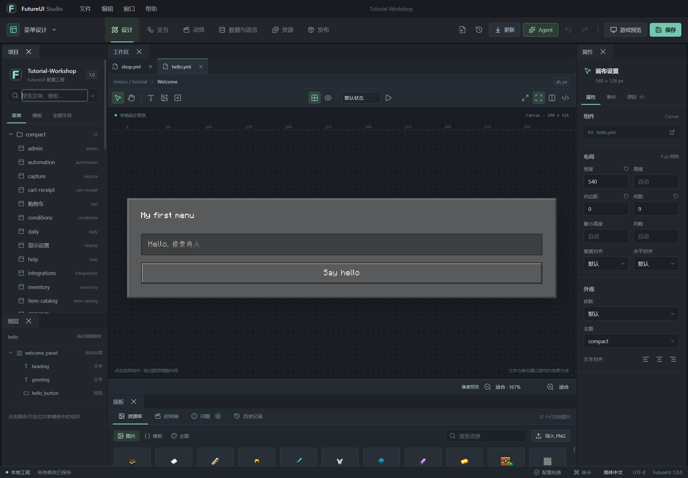

# FutureUI Studio

为 Minecraft FutureUI 菜单制作的桌面编辑工作台。将画布、YAML、动作流程、资源与 AI Agent 放在同一个工程中，修改先预览，再保存和发布。

A desktop editor for Minecraft FutureUI menus, combining a canvas, YAML, action flows, assets and an AI Agent. Review changes before saving and deploying them.



## 下载 / Downloads

当前版本：**0.1.2 · Windows x64**。

| 文件 / File | 下载 / Download |
| --- | --- |
| 安装版，支持应用内手动更新 / Installer with manual in-app updates | [Setup 0.1.2](https://github.com/Ti-Avanti/FutureUI-Studio/releases/download/v0.1.2/FutureUI-Studio-Setup-0.1.2.exe) |
| 便携版 / Portable | [Portable 0.1.2](https://github.com/Ti-Avanti/FutureUI-Studio/releases/download/v0.1.2/FutureUI-Studio-0.1.2-Portable.exe) |
| 全部版本与更新说明 / Versions and release notes | [Releases](https://github.com/Ti-Avanti/FutureUI-Studio/releases) |

普通用户只需下载安装版或便携版，无需单独安装 Node.js。`.blockmap` 与 `latest.yml` 供更新程序使用。便携版需要先安装一次 Setup 才能使用应用内安装更新。

Users need only the installer or portable build; a separate Node.js installation is not required. The `.blockmap` and `latest.yml` files are updater metadata. Install Setup to enable in-app update installation.

## 使用手册 / User guides

两份手册各 **32 页**，包含真实界面截图、可点击目录、逐步练习和常见问题。英文版保留中文界面标签并附解释，方便对照软件操作。界面当前为中文；底部语言选择用于菜单预览。

Both **32-page** guides include actual screenshots, clickable contents, step-by-step exercises and troubleshooting. The English guide retains Chinese UI labels with explanations. The application UI is currently Chinese; its language selector changes the menu preview.

- [中文 PDF · 下载](https://github.com/Ti-Avanti/FutureUI-Studio/releases/download/v0.1.2/FutureUI-Studio-Guide-zh-CN.pdf) · [仓库内预览](docs/manuals/FutureUI-Studio-Guide-zh-CN.pdf)
- [English PDF · Download](https://github.com/Ti-Avanti/FutureUI-Studio/releases/download/v0.1.2/FutureUI-Studio-Guide-en.pdf) · [Repository preview](docs/manuals/FutureUI-Studio-Guide-en.pdf)
- [教程示例 ZIP / Tutorial examples](https://github.com/Ti-Avanti/FutureUI-Studio/releases/download/v0.1.2/FutureUI-Studio-Tutorial-Examples.zip) · [Browse examples](docs/manuals/examples)

手册覆盖安装、工程目录、画布与源码、布局与模板、交互、变量与语言、商品数据、资源、动画、导入合并、导出、操作节点与保存节点、模型连接、Skill、多会话与压缩、服务器发布和更新。

The guides cover installation, project structure, canvas and source editing, layouts/templates, interactions, variables/languages, products, assets, animation, merging, exporting, operation history, saved restore points, model connections, Skills, sessions, compression, deployment and updates.

## 开始使用 / Getting started

1. 安装并启动 Studio；通过“文件 > 新建工作工程”创建练习工程。 / Install Studio and create a practice project with 文件 > 新建工作工程.
2. 解压教程 ZIP，按 `Ctrl+Shift+I`，只导入 `01-first-menu` 目录。 / Extract the tutorial ZIP, press `Ctrl+Shift+I` and import only `01-first-menu`.
3. 打开 `menus/tutorial/hello.yml`，选中按钮并修改文字；按 `Ctrl+S` 保存。 / Open `menus/tutorial/hello.yml`, select the button, edit its label and save with `Ctrl+S`.
4. 按手册练习合并补丁、语言文件、导出和回退。两个示例 `hello.yml` 指向同一个目标，请分步导入。 / Follow the guide to merge the patch, add translations, export and restore. The two sample `hello.yml` files share a target; import them in separate steps.
5. AI 为可选功能：填写自己的 Base URL、API Key、模型 ID 和上下文上限，再启用所需 Skill。 / AI is optional: configure your Base URL, API key, model ID and context limit, then enable the required Skills.

## 功能 / Features

- 可停靠工作区、像素画布、YAML 并排编辑、图层、属性、动作与帧动画。 / Dockable workspace, pixel canvas, split YAML view, layers, properties, action flows and frame animation.
- YAML、ZIP 和目录导入；按组件 ID 合并；逐字段冲突选择与差异预览。 / YAML, ZIP and directory import, component-ID merging, per-field conflict choices and diff previews.
- 导出当前、所选或未保存配置，可包含资源。 / Export current, selected or unsaved configurations, optionally including assets.
- 200 个会话操作节点；最多 30 个持久保存节点，保存节点总量不超过 256 MB。 / Up to 200 session operations and 30 persisted YAML restore points, bounded to 256 MB.
- 自带模型的 Agent，支持 Chat Completions、Responses、Anthropic Messages、流式输出、资源上下文、Skill、多会话与自动上下文压缩。 / Bring-your-own-model Agent with Chat Completions, Responses, Anthropic Messages, streaming, asset context, Skills, multiple sessions and automatic context compression.
- 新版提醒、用户确认下载、差分下载及完整包回退、安装后自动启动。 / Update notifications, user-initiated downloads, differential downloading with full-download fallback, and relaunch after installation.

本地预览与配置检查不执行真实交易、服务器命令或实时 PAPI 查询。部署后仍需在目标服务器和客户端验证。配置保存节点只还原 YAML；图片等二进制资源应随完整工程备份。

Local previews and validation do not execute real purchases, server commands or live PAPI queries. Verify on the target server and client after deployment. Restore points cover YAML only; back up binary assets with the full project.

## 从源码构建 / Build from source

使用 Node.js 22 和 npm，在本目录执行： / With Node.js 22 and npm, run in this directory:

```sh
npm ci
npm run build
npm start
```

Windows 安装包与便携版： / Windows installer and portable build:

```sh
npm run dist:win
```

输出位于 `release/`。以匹配 `package.json` 的 `v` 标签发布时，GitHub Actions 会检查版本和手册校验值，构建 Windows 包，并发布程序、更新元数据、两份 PDF 和教程 ZIP。

Outputs are in `release/`. Pushing a `v` tag matching `package.json` triggers GitHub Actions to check version identity and manual checksums, build Windows packages, and publish binaries, update metadata, both PDFs and the tutorial ZIP.

## 维护手册 / Maintain the guides

双语内容位于 `docs/manuals/content/`，截图位于 `docs/manuals/assets/`。在 Windows 上安装 Python 依赖 `reportlab` 和 `Pillow` 后运行： / Bilingual content lives in `docs/manuals/content/`, with screenshots in `docs/manuals/assets/`. On Windows, install Python dependencies `reportlab` and `Pillow`, then run:

```sh
python docs/manuals/build_manuals.py
```

默认使用系统的微软雅黑和 Consolas，PDF 嵌入字体子集，不分发原始字体。更换版本时更新对应说明、截图和示例；重新生成后检查每页排版，再提交 PDF、ZIP 与 `manifest.json`。 / The builder uses system Microsoft YaHei and Consolas, embedding font subsets without distributing original font files. When releasing a new version, update instructions, screenshots and examples; rebuild, inspect all pages, then commit the PDFs, ZIP and `manifest.json`.

[问题反馈 / Report an issue](https://github.com/Ti-Avanti/FutureUI-Studio/issues)
